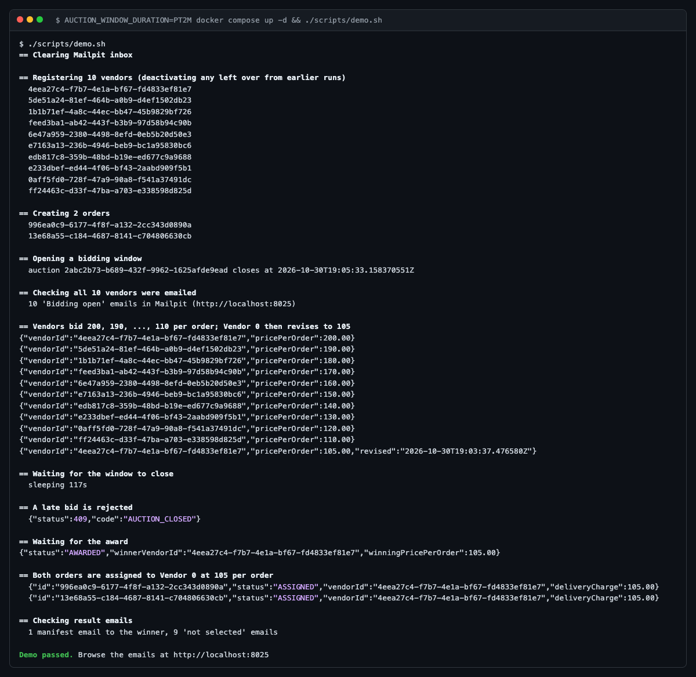
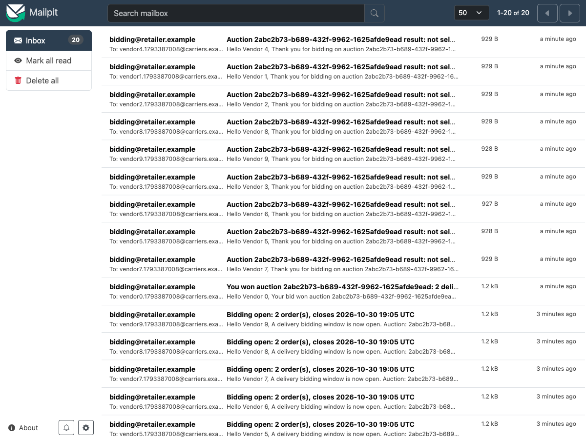
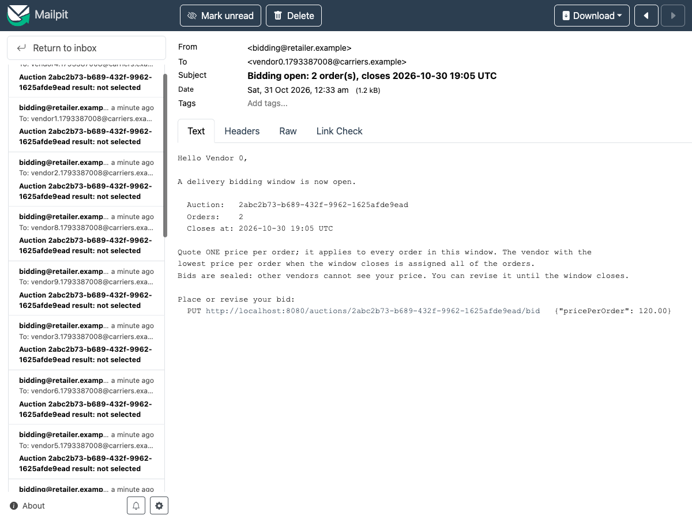
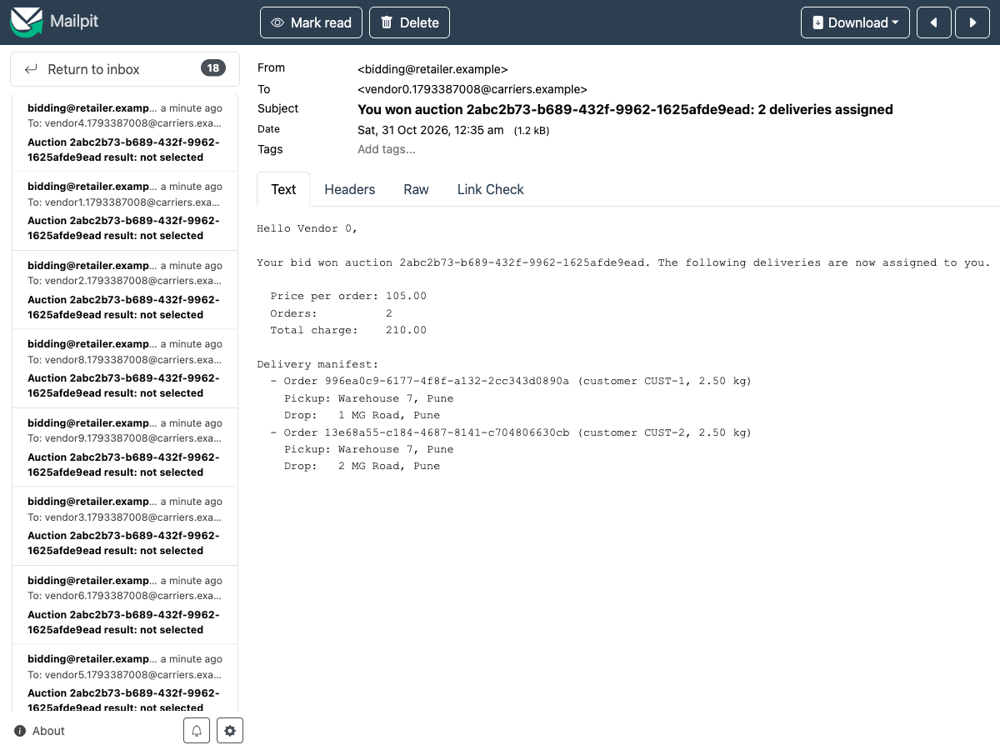
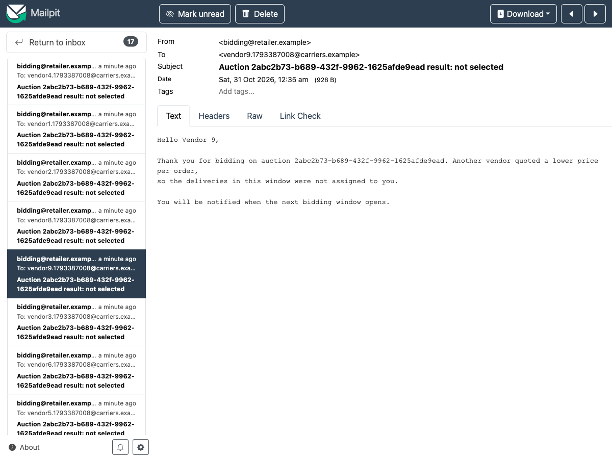

# Delivery Bidding Platform

Microservices for running a 1-hour bidding window among delivery vendors:

1. An admin opens a window for a set of orders.
2. Every active vendor is emailed.
3. Each vendor submits a sealed bid: one price per order, which they can revise until the window closes.
4. The lowest price per order wins every order in the window.

See [docs/HLD.md](docs/HLD.md) for the full design.

| Service | Port | Role |
|---|---|---|
| api-gateway | 8080 | The only public entry point: JWT auth, role checks, routing |
| vendor-service | 8081 | Vendor registry |
| order-service | 8082 | Orders; locks them to a window, assigns them to the winner |
| auction-service | 8083 | Windows, sealed bids, closing, winner selection, outbox |
| notification-service | 8084 | Emails: window opened, won (with delivery manifest), not selected |

Infrastructure: PostgreSQL (one database per service), Kafka (KRaft), and Mailpit (a local SMTP server with a web UI).

## Prerequisites
- JDK 21+ and Maven 3.9+
- Docker (for the stack and for the Testcontainers-based tests)

## Run the tests
```bash
mvn verify
```

## Run the stack and the end-to-end demo
```bash
mvn package -DskipTests
AUCTION_WINDOW_DURATION=PT2M docker compose up -d --build   # leave out the variable for 1-hour windows
./scripts/demo.sh
```
The demo registers 10 vendors and creates 2 orders. It then opens a window and checks that all 10 vendors got an email. Next, every vendor bids, and one vendor revises its price lower. Finally the demo checks four things:
- a bid after the deadline is rejected with `409 AUCTION_CLOSED`
- both orders are assigned to the lowest bidder
- the winner gets the delivery manifest
- the other 9 vendors get a "not selected" email

Open http://localhost:8025 to read the emails. Stop the stack with `docker compose down` (add `-v` to also wipe the database).

### Screenshots
These come from one demo run with a 2-minute window.

**Demo script output:** vendors bid, a late bid is rejected, and both orders are assigned to the lowest bidder.



**Mailpit inbox:** 10 "Bidding open" emails, then 1 winner email and 9 "not selected" emails.



| Window opened (sent to every active vendor) | Winner: delivery manifest | Other bidders: not selected |
|---|---|---|
|  |  |  |

## Calling the API by hand
```bash
ADMIN=$(curl -s -X POST localhost:8080/auth/dev-token -H 'Content-Type: application/json' \
  -d '{"role":"ADMIN"}' | jq -r .accessToken)

curl -s -X POST localhost:8080/vendors -H "Authorization: Bearer $ADMIN" -H 'Content-Type: application/json' \
  -d '{"name":"Speedy Logistics","email":"bids@speedy.example"}'

curl -s -X POST localhost:8080/orders -H "Authorization: Bearer $ADMIN" -H 'Content-Type: application/json' \
  -d '{"customerRef":"C-1","pickupAddress":"Warehouse 7","dropAddress":"221B MG Road","weightKg":2.5}'

curl -s -X POST localhost:8080/auctions -H "Authorization: Bearer $ADMIN" -H 'Content-Type: application/json' \
  -d '{"orderIds":["<order-id>"]}'

VENDOR=$(curl -s -X POST localhost:8080/auth/dev-token -H 'Content-Type: application/json' \
  -d '{"role":"VENDOR","vendorId":"<vendor-id>"}' | jq -r .accessToken)

curl -s -X PUT localhost:8080/auctions/<auction-id>/bid -H "Authorization: Bearer $VENDOR" \
  -H 'Content-Type: application/json' -d '{"pricePerOrder":120.00}'
```

## Configuration
| Variable | Default | Meaning |
|---|---|---|
| `AUCTION_WINDOW_DURATION` | `PT1H` | How long a bidding window stays open (ISO-8601 duration) |
| `GATEWAY_JWT_SECRET` | dev value | HMAC key for JWTs, at least 32 bytes. Always override outside local development. |
| `GATEWAY_DEV_TOKEN_ENABLED` | `false` | Turns `/auth/dev-token` on (the local `docker-compose.yml` sets `true`). Never enable it where real users exist: anyone who can reach it can mint an ADMIN token. While it is off, tokens it issued are rejected. |
